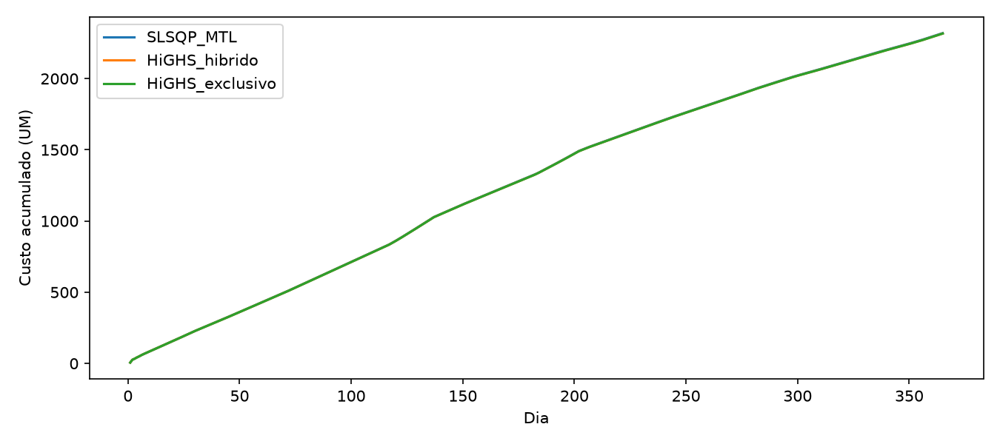
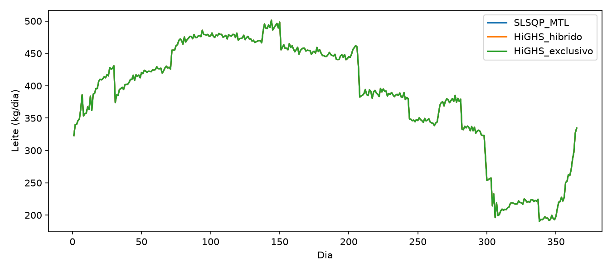

# Resultados oficiais e experimentos complementares
[Sumário](README.md)

## Comparação anual vigente — 365 dias

Mesmas condições iniciais, semente 42, clima de 2013, composição, preços, manejo e política mineral NRC 2005. Requisitos NRC 2001; 26 animais iniciais efetivos.

| Indicador | SLSQP controlado | HiGHS híbrido ampliado | HiGHS exclusivo |
|---|---:|---:|---:|
| Consumo valorizado, UM | 2.319,34875854 | 2.316,45106770 | 2.316,45106770 |
| Despesa de compra, UM | 2.323,21061538 | 2.320,31250669 | 2.320,31250669 |
| Leite total, kg | 140.223,666523 | 140.223,666523 | 140.223,666523 |
| Formulações HiGHS aceitas | 0 | 1.002 | 1.002 |
| Chamadas SLSQP | 1.002 | 0 | 0 |
| Curral-dias adultos aprovados | 362 | 998 | 998 |
| Curral-dias adultos reprovados | 636 | 0 | 0 |
| Curral-dias de bezerros não aprovados | 252 | 252 | 252 |

A redução no consumo valorizado é **0,1249355%**, ou 2,89769084 UM. Os preços são demonstrativos; não se trata de economia comercial universal. Estados biológicos e leite iguais foram observados sob o modelo original, sem modificação para gerar diferenças.

Das 1.002 formulações HiGHS, **959 convergiram**, **42 estagnaram** e **uma atingiu o orçamento**, conservando soluções viáveis nas 43 sem convergência. Não há certificado de ótimo global não linear. Os 998 curral-dias adultos respeitaram os tetos totais Ca/P.

As 636 reprovações do SLSQP controlado correspondem a 751 ocorrências de critérios, todas abaixo de 10⁻³ na unidade própria na auditoria. Foram mantidas como reprovações; esse limiar apenas classifica a análise. Os cinco campos não aprovados de bezerros são discutidos no [capítulo 5](05-restricoes.md). Não se anuncia 100% de aprovação nutricional do rebanho.

[Diários, resumos, CSVs, ofertas, requisitos e XML oficiais](../../evidencias/correcao_dinamica/README.md).

## LP estático — cenário independente

Os exemplos individuais usam sete dias de alocação, PB mínima 3,6 kg/dia, NEL 35 Mcal/dia e FDN 28–40% MS. Seus custos R$ não são custos anuais UM.

| Animal / leite assumido | P/Ca ativos | Alimentos | LP | R$/dia | Parecer |
|---|---|---:|---|---:|---|
| 98605 / 30 kg | Não | 3 | optimal | 35,1059 | Reprovada por P |
| 98605 / 30 kg | Sim | 3 | infeasible | — | Sem avaliação |
| 98605 / 30 kg | Sim | 4 | optimal | 35,3416 | Aprovada nos critérios nativos |
| 93785 / 31 kg | Não | 3 | optimal | 34,9440 | Reprovada por P |
| 93785 / 31 kg | Sim | 3 | optimal | 38,2663 | Aprovada nos critérios nativos |
| 93785 / 31 kg | Sim | 4 | optimal | 35,2480 | Aprovada nos critérios nativos |

As referências suplementadas têm 15 checks LP e 11 critérios nativos atendidos; os parâmetros estão no [capítulo 3](03-dados.md). A comparação A/B e sensibilidade permanecem nas [evidências estáticas](../../evidencias/comparacao/README.md).

## Histórico da correção

A primeira rodada anual tinha custo SLSQP de 2.319,219171 UM e híbrido de 2.529,218830 UM, aumento de 9,05%. Aproximadamente 210 UM da diferença estavam no primeiro dia. O raio fixo e a parada na primeira aprovação mantinham suplementação excessiva.

A reprodução exata reduziu o custo da candidata de lactação de 26,59265535 para 0,34534027 UM/vaca/dia, em cinco iterações, sem excluir o primeiro dia. A referência SLSQP daquele mesmo dia era 0,34533963. [Reprodução](../../evidencias/correcao_dinamica/replay_final/primeiro_dia_comparacao.json). As evidências antigas permanecem históricas.
