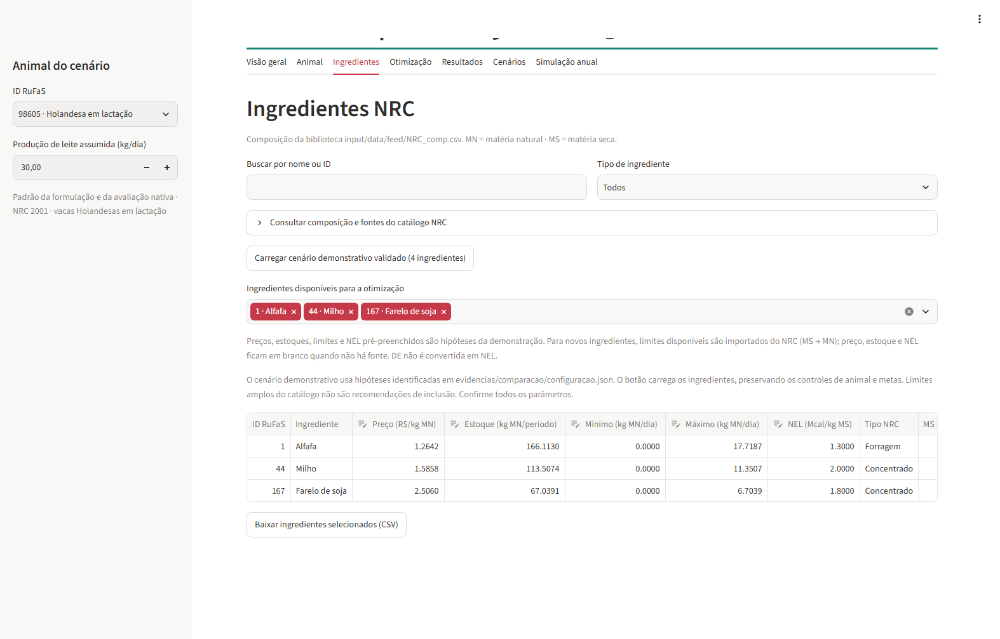
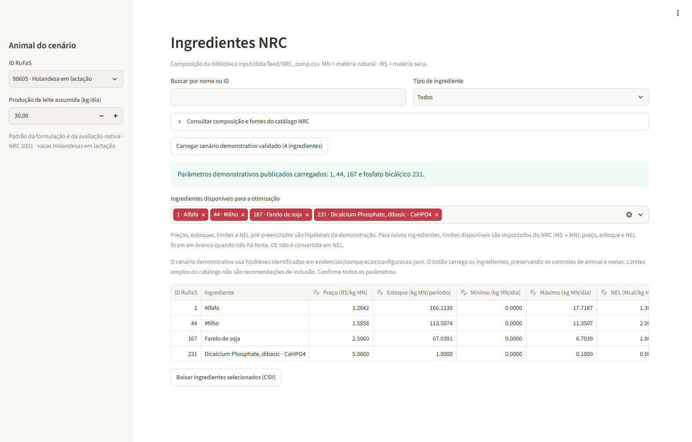
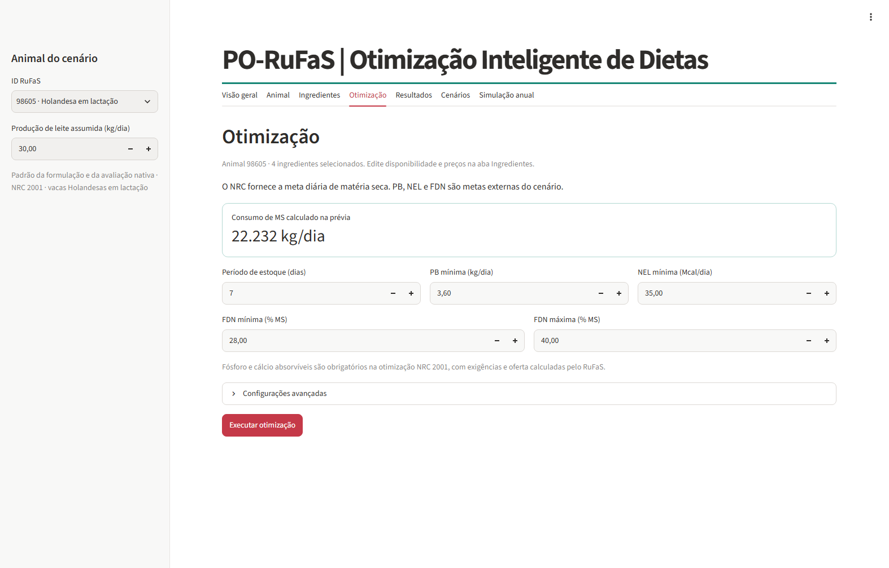
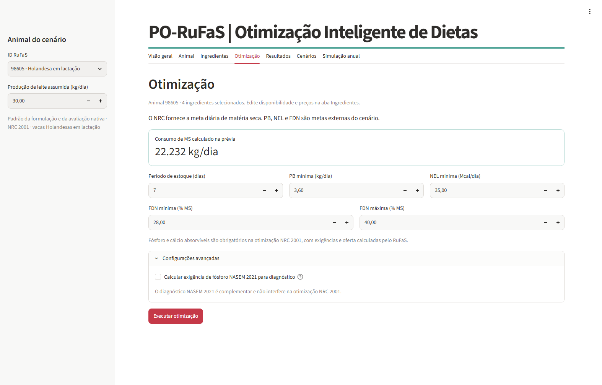
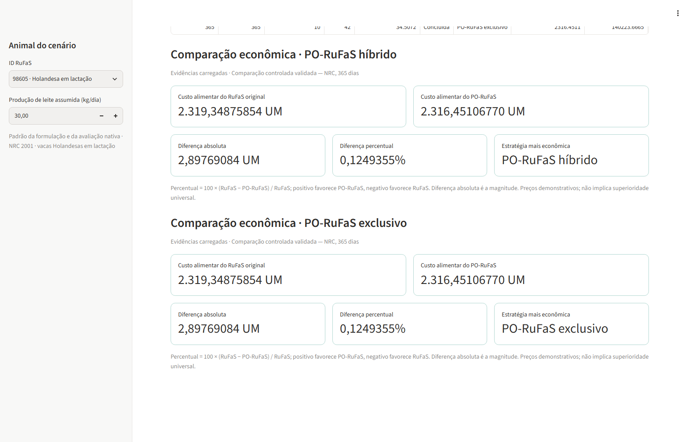
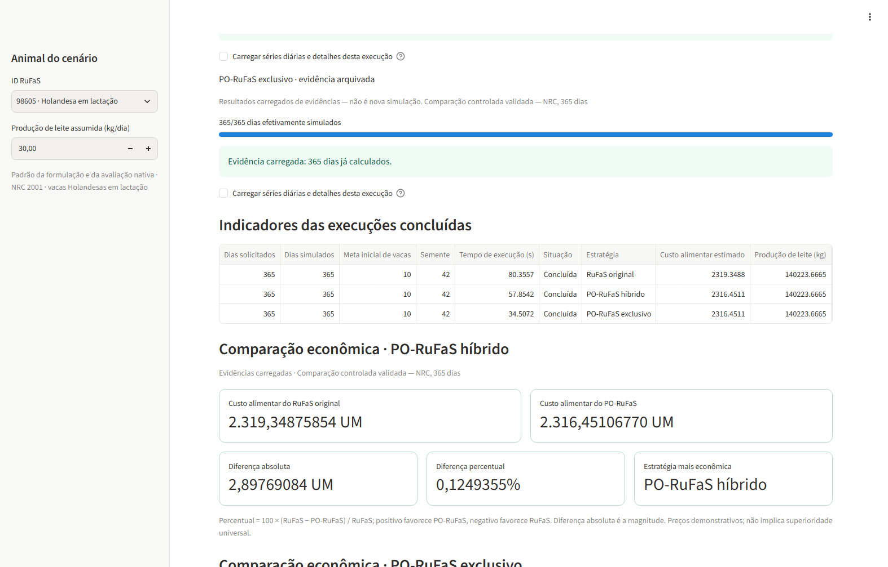

# Manual do usuário e reprodução
[Sumário](README.md)

## Instalação

Python 3.12 foi validado. Na raiz da fonte:

```powershell
py -3.12 -m venv .venv
.\.venv\Scripts\python.exe -m pip install -c constraints-po-rufas.txt -e ".[dev]" -r frontend/requirements.txt
.\.venv\Scripts\python.exe -X utf8 -m streamlit run frontend/app.py --server.address 127.0.0.1 --browser.gatherUsageStats false
```

Abra http://127.0.0.1:8501. Para outra porta, acrescente --server.port 8502. Ctrl+C encerra o servidor. O BAT frontend/iniciar_frontend.bat mantém o atalho para ambiente preparado.

O constraints-release.txt original é histórico; use constraints-po-rufas.txt para esta versão. A cópia de reprodução usa venv nova e não depende do .git da máquina original. [Teste isolado](../../evidencias/publicacao/README.md).

## Sete áreas

1. Visão geral: perfil e fluxo.
2. Animal: registro da população, leite assumido e prévia NRC do cenário estático.
3. Ingredientes: seleção múltipla NRC, composição/limites de fonte identificada, campos pendentes destacados e parâmetros editáveis preservados ao mudar a seleção.
4. Otimização: período, metas fixas e mínimos P/Ca absorvíveis obrigatórios no NRC; diagnóstico separado NASEM em Configurações avançadas.
5. Resultados: status LP, dieta MN/MS, custo, checks e parecer; CSV/JSON/Markdown.
6. Cenários: reotimização, A mesmo LP e B formulações distintas.
7. Simulação anual: ciclo FULL_FARM, seleção de estratégia, progresso e séries reais.

## Exemplo estático e comparação A/B

Os mínimos de P/Ca absorvíveis são obrigatórios na interface NRC 2001 e não possuem caixa de seleção. A referência 98605 com três alimentos fica inviável por fósforo nesse fluxo. Para a suplementada, adicione 231, use os parâmetros do [capítulo 3](03-dados.md) e confira simultaneamente checks e parecer. O caso histórico sem mínimos, com R$35,1059/dia e reprovação por P, permanece reproduzível no backend; seus resultados experimentais não foram alterados.

Em **Configurações avançadas**, inicialmente recolhidas, há um diagnóstico complementar de fósforo NASEM 2021, desativado por padrão. Sua ativação calcula apenas a exigência separada: não muda a dieta, os requisitos nem a otimização NRC 2001.

Na aba Ingredientes, **Carregar cenário demonstrativo validado (4 ingredientes)** preenche os parâmetros publicados de 1, 44, 167 e fosfato bicálcico 231. Eles são demonstrativos, não cotações. Para outros ingredientes, composição/limites disponíveis vêm do NRC; preço, estoque e NEL sem fonte ficam em branco. DE/NDT originais são apresentados sem deduzir NEL. Confira a lista de campos obrigatórios e mantenha suas escolhas: o sistema não adiciona ingredientes para resolver inviabilidade.

Na área Cenários, escolha A ou B, informe repetições e execute a comparação. A exibição distingue convergência do solver, viabilidade e avaliação nativa. Formulações diferentes não permitem atribuir custo menor apenas ao algoritmo.

```powershell
.\.venv\Scripts\python.exe -X utf8 -m RUFAS.biophysical.animal.ration.linear_diet_example
.\.venv\Scripts\python.exe -X utf8 -m experiments.comparison --repeats 5 --output output/comparacao_nova
```

## Cinco opções anuais

| Opção da interface | Estratégias do backend |
|---|---|
| SLSQP nativo controlado | native_slsqp |
| HiGHS híbrido ampliado | linear_highs_all |
| HiGHS exclusivo | linear_highs_exclusive |
| Comparação SLSQP versus HiGHS híbrido | native_slsqp + linear_highs_all |
| Comparação SLSQP versus HiGHS exclusivo | native_slsqp + linear_highs_exclusive |

No exclusivo, a interface informa **sem fallback para SLSQP** e fixa a política fail para essa execução. Uma falha é registrada e interrompe o processo. O modo histórico linear_highs, restrito à lactação, permanece apenas na CLI para reprodução.

Selecione Simulação dinâmica integrada, duração 1–365 dias, semente, meta de vacas, intervalo, ingredientes e preços UM/kg MS. O cenário tem clima de 2013; a política padrão nrc2005_mtl é comum aos dois solvers. Não substitua esses preços demonstrativos por uma cotação parcial sem identificar o novo cenário.

Cada estratégia recebe UUID/pasta e processo próprios. O progresso vem de dias efetivos. Consulte custos, leite, consumo, estoque, minerais por categoria, requisitos e convergência. O JSON de um dia guarda as iterações. O CSV exporta a série. Resultados anteriores ficam em output/annual_ui.

A aprovação adulta e os registros de bezerros aparecem separados. Há 998 curral-dias adultos aprovados na evidência HiGHS e 252 registros de bezerros não aprovados por estratégia. [Interpretação](05-restricoes.md).

Para visualizar anos anteriores sem executá-los novamente, abra **Resultados anuais já calculados**, selecione o conjunto e clique **Carregar resultados anuais das evidências**. O painel identifica evidências arquivadas e novas execuções separadamente. Resumos e cartões aparecem sem ler todos os traços; marque **Carregar séries diárias e detalhes desta execução** quando quiser gráficos e o JSON de um dia. O cache invalida quando o arquivo muda e preserva a precisão.

Os cartões comparam custos reais dos pares do mesmo grupo: RuFaS original, PO-RuFaS, magnitude da diferença, percentual e estratégia mais econômica. A identificação é dinâmica, inclusive quando RuFaS é mais barato ou há empate; não se presume redução. Tabelas e gráficos têm rótulos em português, enquanto o JSON de auditoria mantém os nomes internos. [Detalhes de uso e investigação de desempenho](../../frontend/README.md).

```powershell
.\.venv\Scripts\python.exe -X utf8 -m experiments.annual --days 365 --strategy linear_highs_exclusive --output output/exclusivo_novo
```

Use uma pasta nova: o runner recusa sobrescrever uma execução. --mineral-policy native é somente para reprodução histórica identificada, sem os tetos adicionais.

## Capturas finais reais

As telas abaixo registram a interface real em 28/11/2026, com o cenário demonstrativo publicado e os resultados anuais arquivados. O carregamento não executou novamente os 365 dias. O [manifesto](../../evidencias/frontend_final/telas/manifesto.json) identifica a origem. As [capturas da publicação anterior](../../evidencias/publicacao/telas/manifesto.json), obtidas na cópia isolada, permanecem preservadas como histórico.








## Falhas e limites

Módulo ausente: confira interpretador/instalação. Inviabilidade: reveja entradas, limites e requisitos. Falha exclusiva: consulte summary e log, sem esperar fallback. Porta ocupada: escolha outra. Falta de .git em fonte exportada: commit é indisponível, mas as execuções continuam e o manifesto identifica a origem.

Os 969 testes de referência não certificam nutrição integral, ótimo global não linear ou benefício econômico fora do cenário. [Limitações](13-limitacoes.md).
