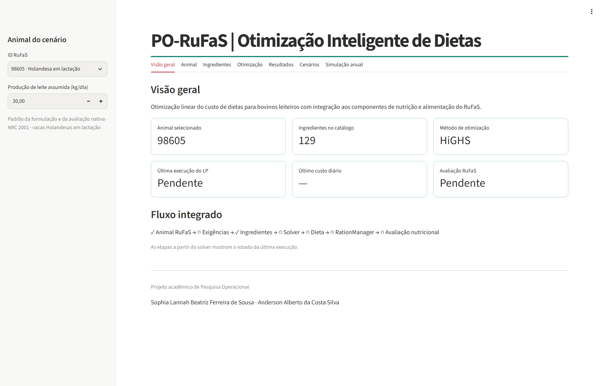
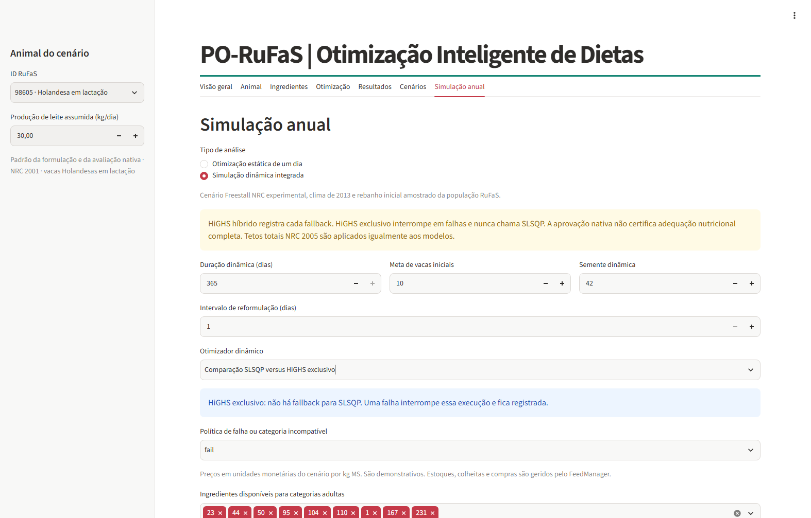
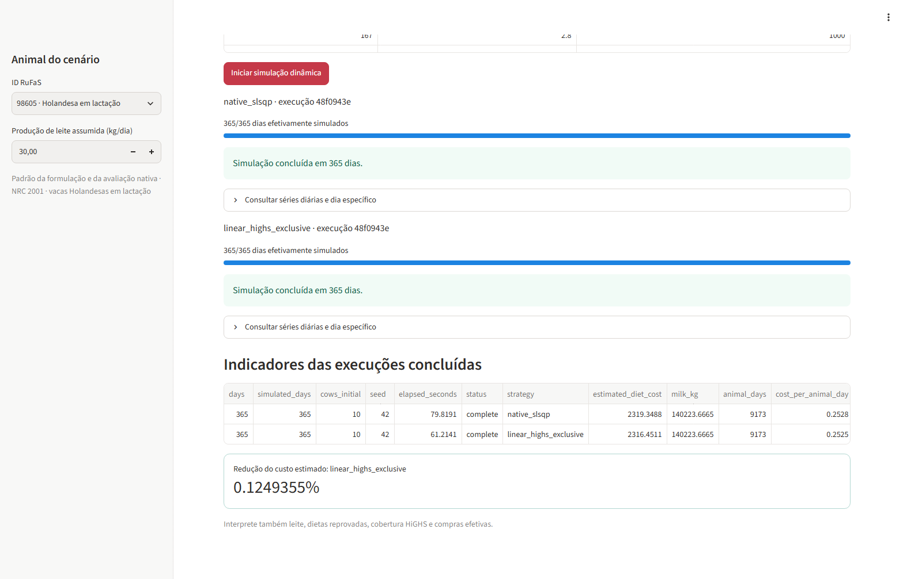

# Manual do usuário e reprodução
[Sumário](README.md)

## Instalação

Python 3.12 foi validado. Na raiz da fonte:

```powershell
py -3.12 -m venv .venv
.\.venv\Scripts\python.exe -m pip install -c constraints-po-rufas.txt -e ".[dev]" -r frontend/requirements.txt
.\.venv\Scripts\python.exe -X utf8 -m streamlit run frontend/app.py --server.address 127.0.0.1 --browser.gatherUsageStats false
```

Abra http://127.0.0.1:8501. Para outra porta, acrescente --server.port 8502. Ctrl+C encerra o servidor. O BAT frontend/iniciar_frontend.bat mantém o atalho para ambiente preparado.

O constraints-release.txt original é histórico; use constraints-po-rufas.txt para esta versão. A cópia de reprodução usa venv nova e não depende do .git da máquina original. [Teste isolado](../../evidencias/publicacao/README.md).

## Sete áreas

1. Visão geral: perfil e fluxo.
2. Animal: registro da população, leite assumido e prévia NRC do cenário estático.
3. Ingredientes: composições de leitura e parâmetros econômicos editáveis.
4. Otimização: período, metas fixas, mínimos P/Ca NRC e diagnóstico separado NASEM.
5. Resultados: status LP, dieta MN/MS, custo, checks e parecer; CSV/JSON/Markdown.
6. Cenários: reotimização, A mesmo LP e B formulações distintas.
7. Simulação anual: ciclo FULL_FARM, seleção de estratégia, progresso e séries reais.

## Exemplo estático e comparação A/B

A referência 98605 com três alimentos, sete dias e minerais desligados custa aproximadamente R$35,1059/dia e reprova por P absorvível. Para a suplementada, adicione 231, use os parâmetros do [capítulo 3](03-dados.md), ative os mínimos e confira simultaneamente checks e parecer.

Na área Cenários, escolha A ou B, informe repetições e execute a comparação. A exibição distingue convergência do solver, viabilidade e avaliação nativa. Formulações diferentes não permitem atribuir custo menor apenas ao algoritmo.

```powershell
.\.venv\Scripts\python.exe -X utf8 -m RUFAS.biophysical.animal.ration.linear_diet_example
.\.venv\Scripts\python.exe -X utf8 -m experiments.comparison --repeats 5 --output output/comparacao_nova
```

## Cinco opções anuais

| Opção da interface | Estratégias do backend |
|---|---|
| SLSQP nativo controlado | native_slsqp |
| HiGHS híbrido ampliado | linear_highs_all |
| HiGHS exclusivo | linear_highs_exclusive |
| Comparação SLSQP versus HiGHS híbrido | native_slsqp + linear_highs_all |
| Comparação SLSQP versus HiGHS exclusivo | native_slsqp + linear_highs_exclusive |

No exclusivo, a interface informa **sem fallback para SLSQP** e fixa a política fail para essa execução. Uma falha é registrada e interrompe o processo. O modo histórico linear_highs, restrito à lactação, permanece apenas na CLI para reprodução.

Selecione Simulação dinâmica integrada, duração 1–365 dias, semente, meta de vacas, intervalo, ingredientes e preços UM/kg MS. O cenário tem clima de 2013; a política padrão nrc2005_mtl é comum aos dois solvers. Não substitua esses preços demonstrativos por uma cotação parcial sem identificar o novo cenário.

Cada estratégia recebe UUID/pasta e processo próprios. O progresso vem de dias efetivos. Consulte custos, leite, consumo, estoque, minerais por categoria, requisitos e convergência. O JSON de um dia guarda as iterações. O CSV exporta a série. Resultados anteriores ficam em output/annual_ui.

A aprovação adulta e os registros de bezerros aparecem separados. Há 998 curral-dias adultos aprovados na evidência HiGHS e 252 registros de bezerros não aprovados por estratégia. [Interpretação](05-restricoes.md).

```powershell
.\.venv\Scripts\python.exe -X utf8 -m experiments.annual --days 365 --strategy linear_highs_exclusive --output output/exclusivo_novo
```

Use uma pasta nova: o runner recusa sobrescrever uma execução. --mineral-policy native é somente para reprodução histórica identificada, sem os tetos adicionais.

## Capturas finais reais

As telas abaixo são capturas do frontend executado na cópia isolada, com resultados do backend; não são maquetes. Os arquivos de captura identificam duração e configuração, sem representar uma execução de um dia como resultado anual.





## Falhas e limites

Módulo ausente: confira interpretador/instalação. Inviabilidade: reveja entradas, limites e requisitos. Falha exclusiva: consulte summary e log, sem esperar fallback. Porta ocupada: escolha outra. Falta de .git em fonte exportada: commit é indisponível, mas as execuções continuam e o manifesto identifica a origem.

Os 954 testes de referência não certificam nutrição integral, ótimo global não linear ou benefício econômico fora do cenário. [Limitações](13-limitacoes.md).
